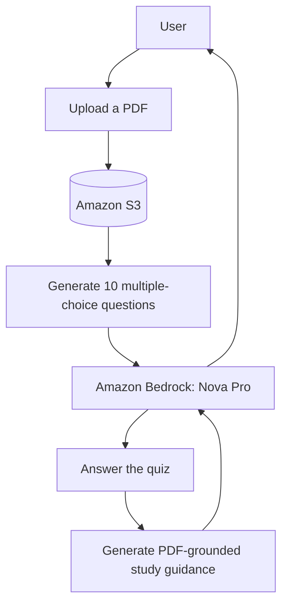

# TrivAI

TrivAI is a demonstration application that turns an uploaded PDF into a focused, multiple-choice assessment and PDF-grounded study guidance.

## How It Works

The application stores the uploaded PDF in Amazon S3. Amazon Bedrock uses only that PDF to generate exactly 10 multiple-choice questions. After the user submits their answers, Bedrock produces study guidance grounded in the same document.

## Repository Structure

- `web/` contains the application and its user interface.
- `infrastructure/` contains the infrastructure definition and deployment configuration.

## Prerequisites

- Node.js and pnpm 11.15.1.
- AWS credentials for the target account.
- Access to the Amazon Bedrock `eu.amazon.nova-pro-v1:0` model in `eu-west-1`.

## Architecture

The AWS CDK stack provisions the following resources:

- An S3 bucket for uploaded documents and public assets.
- An ARM64 Docker-image AWS Lambda function that runs the Next.js application.
- IAM permissions for the Lambda function to access S3 and invoke Amazon Bedrock.
- A CloudFront distribution that serves the application from Lambda and public assets from S3.

## Current Constraints

- Uploads must be PDF files no larger than 1 MiB.
- Uploaded PDFs are stored with generated IDs under `documents/<uuid>.pdf`.
- The first answer in each generated question is the canonical correct answer; the client shuffles choices while retaining that mapping.
- Question sets and quiz attempts are not persisted after the active session.
- The application does not include authentication.
